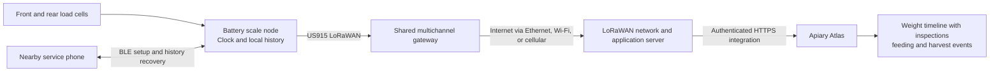

# Apiary Atlas hive scale: market research and proposed prototype

Research date: 2026-09-17. This is a design proposal, not a validated hardware specification or purchasing list. Prices are displayed listings, not landed quotations; regional models, taxes, shipping, gateways, and subscriptions differ. Performance figures below are manufacturer claims unless explicitly labeled as our targets.

## Recommendation

Build a full-hive scale with two instrumented support rails, replaceable electronics, local history, and **LoRaWAN as the primary communications link**. A shared multichannel gateway forwards radio traffic to a LoRaWAN network server, whose application integration delivers readings to Apiary Atlas. Keep Bluetooth for nearby setup, calibration, diagnostics, and bulk history recovery. Start with one powered LoRaWAN gateway and two prototype scales. Prove mechanical stability and temperature performance before designing a custom circuit board.

Design direction updated following the user's preference for LoRaWAN. Bluetooth is no longer the primary yard telemetry link; LoRaWAN is part of the initial prototype, not a later variant.

Assumptions: initially stationary Langstroth hives, US deployment, access to power and Wi-Fi for the first test yard, eventual remote yards. Confirm actual bottom-board dimensions, maximum loaded hive weight, yard spacing, and connectivity before ordering mechanical parts. Do not make a cellular subscription necessary for each hive.

The value is reliable weight history joined to the beekeeper's inspections, feeding, equipment changes, harvests, weather, and bloom records. A scale alone cannot identify honey weight, starvation, swarming, or colony death with certainty.

## Market comparison

| System | Verified design and advertised features | Price context | Lesson for Atlas |
|---|---|---|---|
| BroodMinder W5 | One 200 kg load cell under one edge; opposite edge rests on a spacer. BLE to phone or hub. Documentation recommends up to 400 kg hive weight and claims 4–5 years on two AA batteries at hourly logging. | Europe collection displayed from US$254; region and configuration matter. | Simple installation and low power are valuable; partial-support measurement requires care when interpreting total weight. |
| BroodMinder W3 | Four sensors measure the full hive; assembled, partially assembled, and DIY options. Advertised 200 kg capacity, 5 g resolution, temperature compensation, and five-year battery life. | Europe collection displayed US$234 for DIY; verify exact kit contents. | Closest reference for an affordable full-hive DIY product. |
| BEEP base v3.7 | Full platform with 150 kg sensor, weight/temperature/sound, LoRaWAN and BLE. Two AA batteries, external battery access, real-time clock, 8 MB storage advertised for two years. Open designs and API access. Listed radio is EU868. | €495 including VAT; gateway or network service may be additional. | Strongest open reference; service access and accurate offline timestamps belong in v1. US radio compatibility needs a separate solution. |
| HiveWatch | 200 kg, 10 g resolution, LTE-M transmitter supports up to eight scales; three AA batteries. | €589 one-scale starter or €997 three-scale bundle; online service €79 for one year per transmitter. VAT included in displayed prices. | Share connectivity cost across the yard. |
| SolutionBee HM-6H | 350 kg platform; hourly weight and temperature, Wi-Fi upload, optional HiveHub for remote sites. | Current hardware price not verified. Datasheet is dated 2023; confirm current availability. | Useful US reference for heavier hives and backyard Wi-Fi. |
| Wolf ApiGraph 4 | 200 kg, two temperature-compensated load cells, five-minute measurements, LTE connection. | Shop displayed from €861.07, SIM €25/year and software €36/year; configuration affects total. | Dual sensing and serviceable connectivity are useful premium features. |

Sources: [W5 documentation](https://doc.mybroodminder.com/37_sensors_W5/), [W3 documentation](https://doc.mybroodminder.com/33_sensors_W3_intro/), [BroodMinder regional prices](https://eu.broodminder.com/collections/hive-sensors), [BEEP v3.7 listing and specifications](https://www.beep-shop.nl/a-99225012/producten/beep-base-v3-7/), [HiveWatch](https://hivewatch.ch/en), [SolutionBee HM-6H datasheet](https://solutionbee.com/wp-content/uploads/2023/01/B-ware%E2%84%A2-HM-6H-Datasheet.pdf), [Wolf shop](https://www.shop.wolf-waagen.de/LTE-Beehive-Scale-ApiGraph-4_2).

BroodMinder's original W was discontinued in February 2026 according to its [legacy documentation](https://doc.mybroodminder.com/32_sensors_W/). Use W3/W5 as current references. Also distinguish display resolution from accuracy: a 5 g increment does not establish 5 g outdoor accuracy. Published W5 capacities differ across documentation and retailer descriptions; verify the regional model before buying a reference unit.

## What to copy conceptually, and what to improve

Use BroodMinder's low-power sensor/shared-hub pattern and W3's whole-hive measurement. Use BEEP's accessible battery compartment, local logging, real-time clock, and published interfaces. Study open hardware licenses before reusing files or code; these recommendations do not require copying proprietary electronics or protocols.

BEEP's [earlier engineering report](https://beep.nl/measurement-system-2/technical-specifications/beep-base-version-2) describes difficulty maintaining stable weight readings under long-term loading and temperature changes. That is evidence of the engineering challenge in an older prototype, not a finding that current BEEP products are defective. Our first milestone must be a stable instrument, not an attractive chart.

For a scale supporting only one edge, doubling the measured reaction assumes the center of mass is halfway between the supports. If that reaction changes from 50% to 55% of a constant 100 kg hive, doubling reports 110 kg. This is a statics example, not a measured BroodMinder error. Measuring both supports avoids that particular estimation error.

## Proposed hardware

### Mechanical arrangement

Two low-profile rails, one at the front and one at the rear, joined by rigid spacers. Each rail has an upper hive support and lower stand support, connected through a sealed, compensated single-point load cell. The whole hive load must pass through those two cells. Sum independently calibrated front and rear readings.

- Initial rated system target: 250 kg / 551 lb. Select each cell against the worst allowed uneven loading, not simply half of total weight. Candidate range: 200–250 kg per cell; exact model remains open.
- Only use a single-point cell whose specified platform dimensions and off-center loading limits support the rail width. Ordinary beam cells cannot be substituted without redesigning the load introduction.
- Make rail spacing adjustable to the user's actual bottom boards. A rigid frame should spread load without twisting the cells; verify corner loading and uneven stands experimentally.
- Provide overload stops with controlled clearance, lateral restraint, drainage, corrosion-resistant fasteners, and cable strain relief. Stops must not carry normal load.
- Put batteries and electronics in a shaded side enclosure accessible without lifting the hive. Target an IP67 enclosure assembly; do not claim that rating until the assembled product is tested.
- Keep the radio antenna outside the metal frame's shadow. Protect exposed sensor cables from rodents and tools.
- Any strap preload across the weighing interface changes readings. Define approved strap routing and check it during calibration. Transport loads require a separate validated restraint arrangement.

Alternative for a lower-cost experiment: four load cells in a full frame, similar in principle to W3. This adds corner matching and more exposed connections. A single central platform cell is another viable option if its platform rating and frame geometry fit the hive. Compare mechanically before committing to production tooling.

### Electronics and firmware

- Prototype with a low-power controller plus a region-appropriate LoRaWAN radio/module. An nRF52840 can retain BLE setup and external flash support, but it does not contain a LoRa radio: it needs a separate sub-GHz transceiver and LoRaWAN stack, or an integrated module that combines those functions. Select the module, stack, US915 support, antenna, and peak-current requirements together. [Nordic specifications](https://www.nordicsemi.com/Products/nRF52840).
- Evaluate a two-channel ADS1232 bridge ADC with ratiometric excitation/reference and separately calibrated channels. Its 24-bit designation is not a system accuracy promise. Account for channel settling and bridge warm-up. HX711 is a reasonable inexpensive comparison board. [TI ADS1232](https://www.ti.com/product/ADS1232).
- Measure temperature near the load cells for compensation. Label that separately from true ambient temperature; a sun-heated frame is not a weather station. Add an optional brood temperature probe later.
- Include a real-time clock, nonvolatile calibration records, external flash, battery-voltage measurement, watchdog, and physical setup button. Preserve calibration across firmware updates.
- Use replaceable primary AA cells and a regulator sized for the selected bridges and radio, including LoRa transmit-current peaks. Aim for at least one year, then measure it. Two energized 350-ohm bridges at 3.3 V alone draw about 19 mA; two seconds every five minutes averages about 126 microamps before the rest of the system. Include LoRa airtime, receive windows, join attempts, retries, and cold-battery voltage sag in the power budget. Settling duration can dominate the battery budget.
- Sample every five minutes initially. Power bridges only for a validated settling/acquisition window, filter a short burst, and retain both channel values and quality flags. Optional faster event sampling follows power and detection tests.
- Reserve at least 90 days of local history. At 64 bytes per record and five-minute samples, 90 days needs about 1.66 MB before metadata; 8 MB flash provides comfortable margin. Persist sequence state safely and test interrupted writes.
- Never automatically zero a loaded hive: that would erase winter consumption and creep into the same baseline. Tare, calibration, and equipment offsets are separate, dated operations.

### Connectivity

Use US915 for the assumed United States deployment, with matching node, gateway, and network-server channel plans. Choose a proper multichannel LoRaWAN gateway; a single-channel LoRa receiver is not the pilot gateway. Start with mains power and Ethernet or Wi-Fi backhaul. One gateway can serve multiple scales and potentially multiple nearby yards, but coverage must be measured through actual terrain, wet foliage, and occupied hives. Place its antenna above nearby obstructions; do not promise a fixed range.

Prefer a private, self-hosted ChirpStack deployment as the first network-server candidate, with The Things Stack as an alternative. These components handle LoRaWAN device sessions and network functions; Atlas remains the beekeeping application. ChirpStack supports HTTP event integrations. Its deployment may also use MQTT internally; this does not require Atlas to expose an MQTT ingestion endpoint or put a broker in every yard. [ChirpStack overview](https://www.chirpstack.io/docs/), [HTTP integration](https://www.chirpstack.io/docs/chirpstack/integrations/http.html), [The Things Stack network server](https://www.thethingsindustries.com/docs/concepts/architecture/components/network-server/).

Proposed radio behavior:

- Use battery-friendly Class A nodes and OTAA activation with unique device keys. Protect keys, persist required LoRaWAN counters/session state safely, and use randomized backoff after outages. Device identity belongs to the network, not exclusively to one gateway.
- Measure and retain detailed readings every five minutes. Initially target one compact uplink every 15 minutes, with an additional rate-limited message for a significant change. Five-minute sampling sets the initial event-detection latency; do not promise instantaneous alerts.
- Encode a versioned binary payload with sequence/time information, weight, battery, and quality flags. Send less frequent status messages for firmware/calibration metadata. Validate payload length and airtime at the lowest intended data rate and against the selected network's limits before finalizing the format or cadence. The 64-byte local storage record is not the radio payload.
- Prefer unconfirmed routine uplinks. Reserve scarce downlinks for necessary configuration, occasional recovery requests, and other bounded operations. A LoRaWAN acknowledgment is not proof that Atlas durably stored a measurement.
- Retain at least 90 days on the node. Detect gaps using application sequence numbers; recover recent gaps through a bounded replay scheme without starving current readings. Recover large backlogs locally over BLE rather than flooding the radio network. Exact replay protocol remains a prototype deliverable.
- Do not assume the gateway buffers data during an internet outage. Select and test any store-and-forward feature explicitly; node storage is the baseline recovery mechanism. Add durable retry handling between the network-server integration and Atlas as well.
- Treat remote configuration as eventual: Class A receive opportunities follow uplinks. Use authenticated BLE service access for calibration and firmware updates in v1 instead of depending on bulk LoRaWAN transfers.

Remote yards can use cellular gateway backhaul; no modem or cellular subscription is needed in each scale. Budget gateway power, antenna mounting, cellular service, and network-server hosting separately. Solar is primarily a gateway decision and requires measured continuous consumption plus a winter autonomy budget. No reliable backhaul means delayed uploads and delayed alerts, even though node logging continues.

The phone should initially handle account setup, QR claiming, and charts through Atlas. Do not assume the existing PWA can provide universal direct BLE syncing; a cross-platform field-sync feature requires a separately verified browser or native-app path.

## Atlas integration: existing foundation and required changes

Repository inspection found:

- `backend/internal/httpapi/routes_scale.go`: scale registration by apiary, optional hive association, CSV reading upload, daily series, and deletion. Vendors currently are `broodminder`, `hivetracks`, and `other`.
- CSV parsing retains the calendar day and stores the arithmetic daily mean, minimum, maximum, and sample count. Conflicts are keyed by scale and date. It does not retain the original intraday series.
- `frontend/src/features/apiaries/scale-panel.tsx` and `scale-chart.tsx`: existing scale management, CSV import, and historical display.
- `docs/product-roadmap.md`: CSV ingest is implemented; MQTT ingest is explicitly deferred. A LoRaWAN application integration can deliver HTTPS telemetry to Atlas while network-server infrastructure remains a separate concern.

Preserve the CSV workflow and add a separate raw telemetry path. Do not upload five-minute measurements into the daily CSV endpoint and expect their timing to survive.

Proposed interface, not implemented:

`POST /api/v1/telemetry/batches`

An authenticated integration adapter decodes LoRaWAN application events and submits normalized batches. Each batch identifies the integration and payload version. Each measurement contains device ID, boot/session ID, sequence number, UTC observation time, clock-quality flag, front/rear weights in grams, cell temperatures, battery voltage, firmware version, calibration version, and measurement-quality flags. Some fields can arrive in separate status messages; do not invent missing values or present metadata received later as known earlier. The server records receipt time separately. Retain network metadata such as gateway reception IDs, RSSI, SNR, and frame counter for diagnostics; one uplink may be received by multiple gateways. Diagnostic mode can retain locally recovered ADC counts.

Required backend behavior:

1. Issue revocable integration credentials restricted to explicitly assigned devices/apiaries. Map provisioned LoRaWAN device identities to Atlas scales server-side; do not trust apiary IDs supplied in payloads. Keep LoRaWAN provisioning keys in the network-server provisioning system and node, separate from Atlas API credentials. Enforce authorization on every measurement; do not embed an administrator personal token in hardware.
2. Deduplicate by device, boot/session ID, and sequence. Handle retries, partial batch acceptance, late samples, clock resets, and out-of-order arrival. Return per-record results after durable persistence.
3. Keep immutable raw records with explicit units and versioned calibration. Record device-to-hive assignments with effective dates so moving a scale never rewrites history.
4. Derive daily summaries in the apiary's timezone, retaining legacy CSV provenance. Separate daily mean from end-of-day weight and like-for-like daily change. Never silently replace a daily aggregate with an arbitrary last uploaded batch.
5. Link inspections, feeding, supers added/removed, harvests, relocation, and maintenance to the chart. Preserve physical measurements and calculate an optional adjusted trend separately. Estimated equipment tare must carry uncertainty.
6. Surface last measurement time, last upload time, missing data, low battery, calibration age, and suspect readings. A stale sensor must not appear healthy just because its last weight looked normal.

Recommended initial insights: daily gain/loss, seven-day consumption trend, unusual sustained loss, and device-offline notices. Show explanations such as “Sudden weight loss; check for an inspection, removed equipment, or possible swarm.” Suppress duplicate alerts and annotate known maintenance. Weight does not prove swarming or death, and gross hive weight is not a direct food-store measurement.

## Prototype cost envelope

These are planning allowances in USD for one-off parts, not sourced quotes or retail targets.

| Per-scale item | Allowance |
|---|---:|
| Two documented, sealed load cells | $80–180 |
| Frame, brackets, feet, overload stops | $40–90 |
| Controller/BLE, LoRaWAN radio, antenna, ADC, clock, flash, power components | $55–110 |
| Enclosure, cable glands, connectors, batteries | $25–50 |
| **Per-scale parts subtotal** | **$200–430** |

Allow another $150–400 for a powered multichannel US915 prototype gateway. Two scales and one gateway therefore suggest $550–1,260 in parts, excluding fabrication labor, tools, known calibration masses, shipping, reference equipment, outdoor mounting/protection, hosting, and any cellular/solar system. These revised allowances are not vendor quotations. Get actual radio, gateway, cell, and metalwork quotations before treating this as a budget commitment. A homemade unit is not guaranteed to be cheaper than BroodMinder; direct Atlas integration and repairability are the reasons to build.

## Validation and decision gates

All figures here are proposed acceptance targets, not achieved specifications.

1. **Bench instrument:** validate calibration at zero and multiple loads across the intended range, loading/unloading hysteresis, repeatability, front/rear imbalance, corner placement, and overload-stop operation. Initial stable-condition target: repeatability within 50 g and absolute error within 250 g across the approved operating range. Do not advertise 5 g accuracy.
2. **Loaded environmental test:** hold a nonhygroscopic reference load for at least 30 days; include sun/shade, temperature cycling, rain, condensation, and representative stands. Initial target: unexplained 24-hour drift under 100 g in the tested environmental envelope. Log temperature gradients; measure creep separately from temperature error. A 30-day pass is preliminary, not winter qualification.
3. **Offline, radio, and power test:** verify US915 channel-plan compatibility and OTAA joins; survey reception at all intended hive locations with representative antenna placement. Interrupt internet and radio coverage separately, reboot gateway/node, interrupt flash writes, change batteries, and replay overlapping batches. Test duplicate reception through two gateways, network-server/Atlas outages, frame-counter persistence, bounded recovery, and the lowest intended data rate. Confirm no silent loss or duplication; display unrecoverable gaps explicitly. Measure current over complete acquisition/uplink/receive-window cycles, including join retries and weak-signal operation, then apply cold-battery and capacity margin.
4. **Two-hive pilot:** record known additions/removals and normal inspections, compare against independently known masses or a reference scale, and track nuisance alerts. A sentinel hive indicates its own trend, not every colony's food reserves.
5. **Production decision:** only after a seasonal pilot choose final cell, frame, battery, radio, custom board, environmental rating, and cost target. If commercial sale is intended, include applicable product/radio qualification in that later scope.

Immediate next work: measure the actual hives and stands, document yard spacing and available gateway power/backhaul, pick two candidate load-cell/frame arrangements with datasheets, and shortlist compatible US915 node modules and multichannel gateways. Build the bench instrument plus a simulated LoRaWAN application event decoder and Atlas ingestion path. Validate a real radio link before committing to a custom board. That gives a concrete basis for a parts list and software implementation without prematurely committing to an untested scale design.
